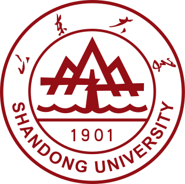
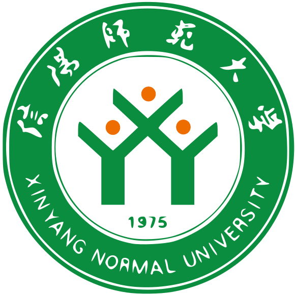

 <h2 id='education'> Education </h2>

- *Sep. 2025 -- Present*, M.S. Student,  School of Mathematics, Shandong University, Jinan, China.  Supervisor: <a href="https://faculty.sdu.edu.cn/wangke12345678/en/">Ke Wang</a>.
- *Sep. 2021 -- Jul. 2025*, B.S.,  School of Mathematics and Statistics, Xinyang Normal University, Xinyang, China. 

<h2 id='haa'> Awards </h2>

- *2025 -- 2026*, Second-Class Scholarship for Graduate Students (Shandong University) .
- *Dec. 2023*, First Prize, 15th Chinese Mathematics Competitions (Mathematics Class A) .
- *Nov. 2023*, Second Prize, 2023 Contemporary Undergraduate Mathematical Contest in Modeling.

<h2 id='conferences'> Conferences </h2>

- None.

<h2 id='experience'> Academic and Professional Experience </h2>

- Teaching Assistant, Topology (Bilingual Course), Spring 2026. 
  <em>School of Mathematics, Shandong University.</em> 

- The 1st Summer Camp of the Chinese Mathematics Competitions, Jul. -- Aug. 2023. 
  <em>Chinese Mathematical Society, Working Group of the Chinese Mathematics Competitions, Jiangsu Normal University.</em>
  
<h2 id='misc'> Misc </h2>

- Here is my CV ([cv-zh](/ref/cv.pdf), [cv-en](/ref/cv-en.pdf)). 
